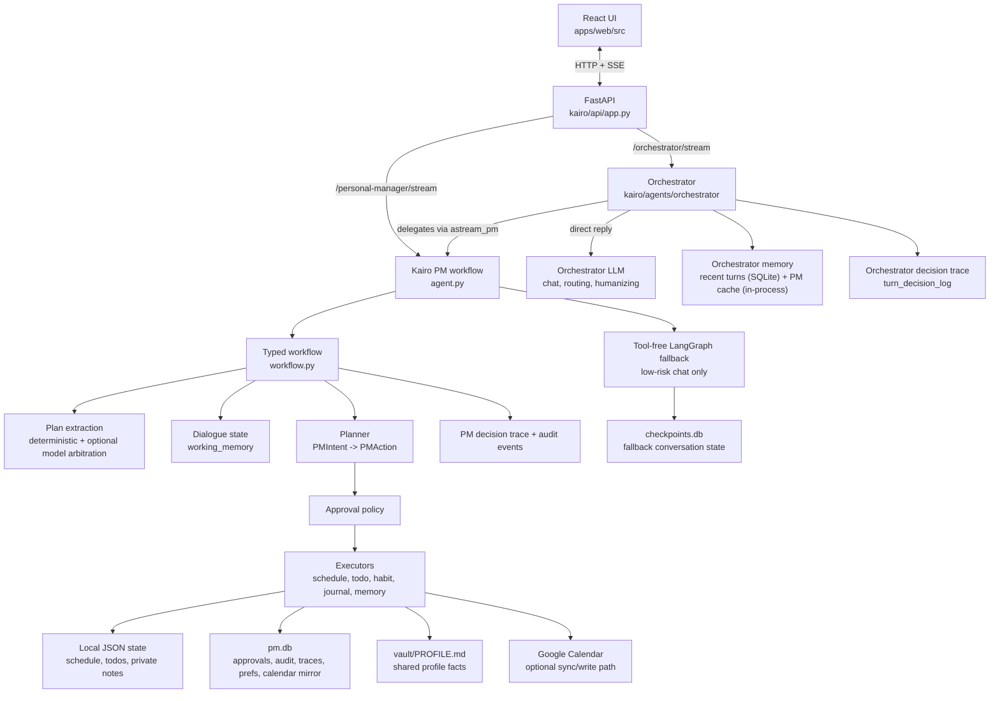
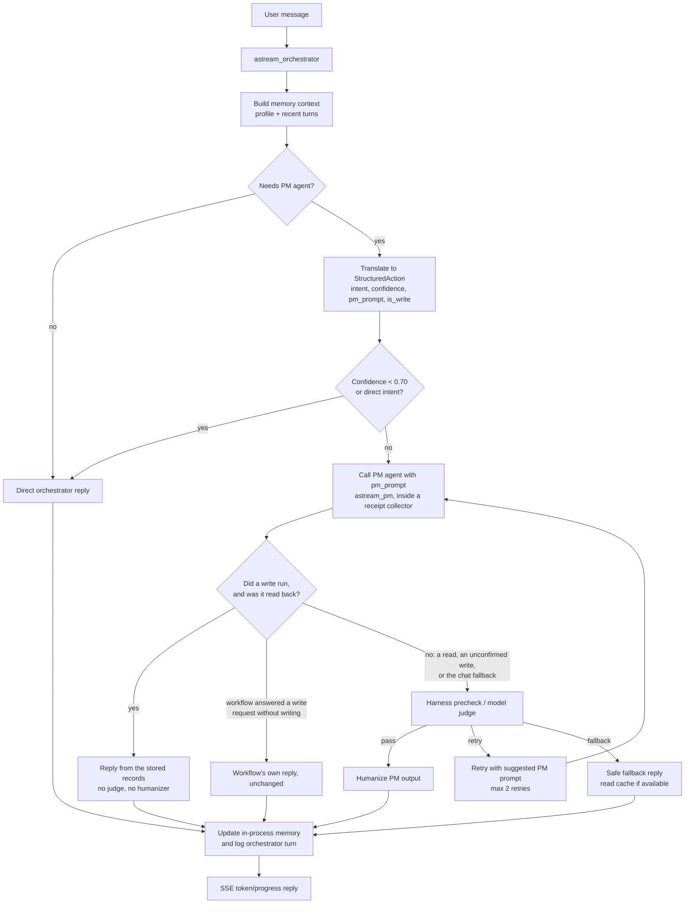
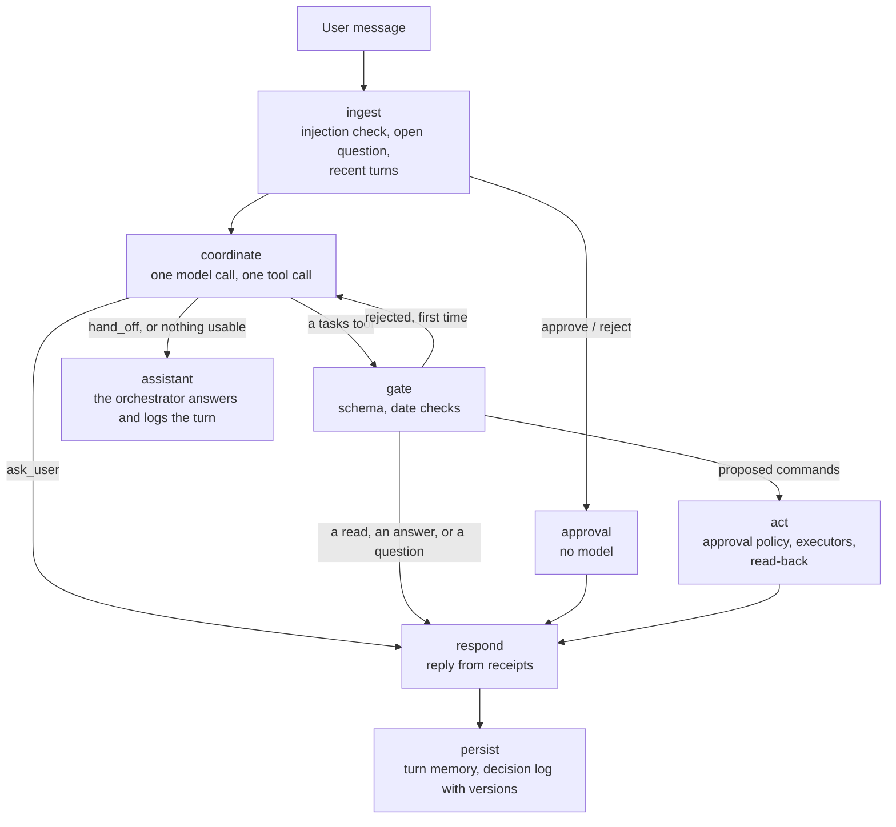
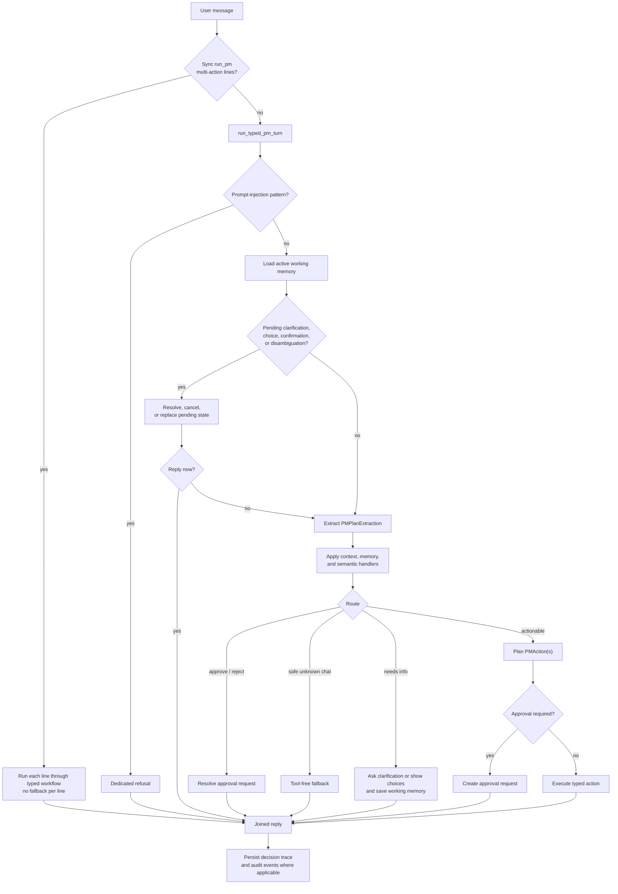
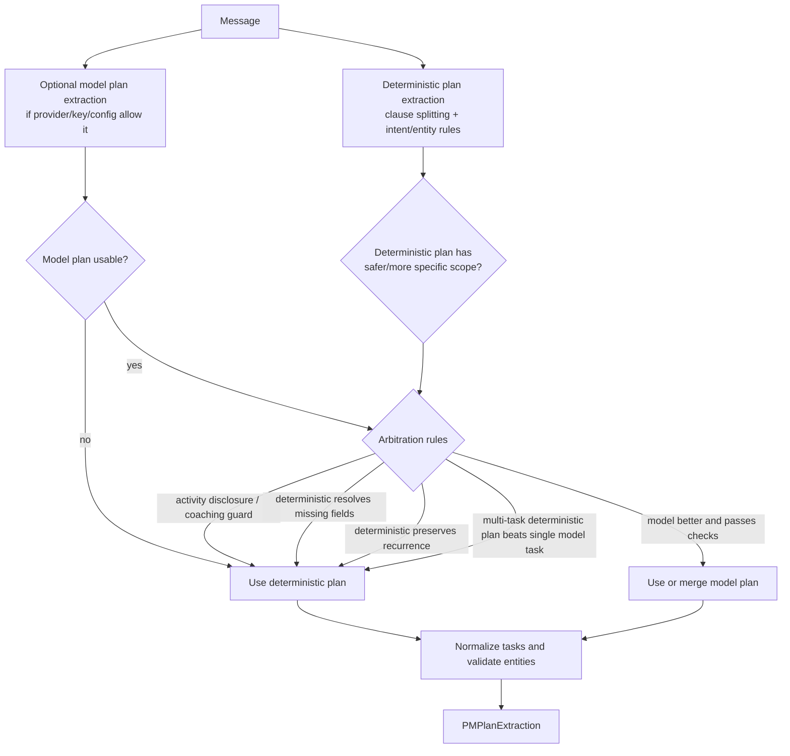
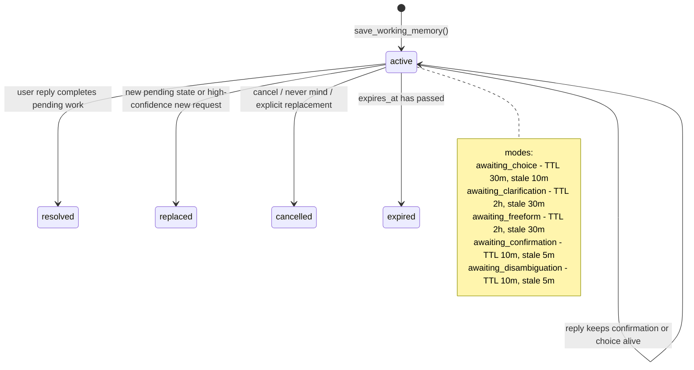
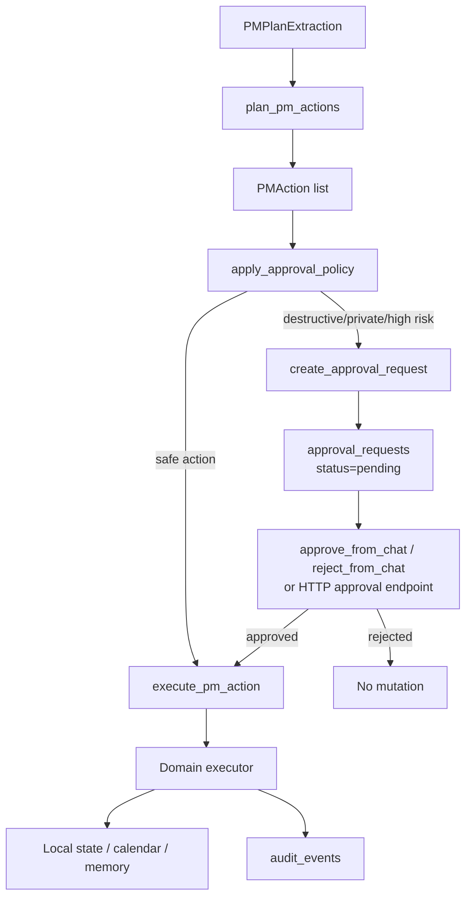
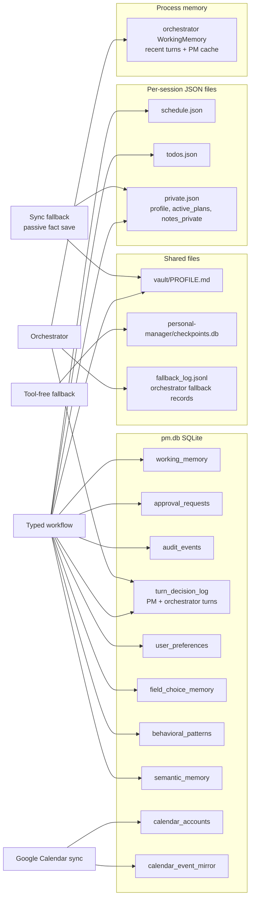
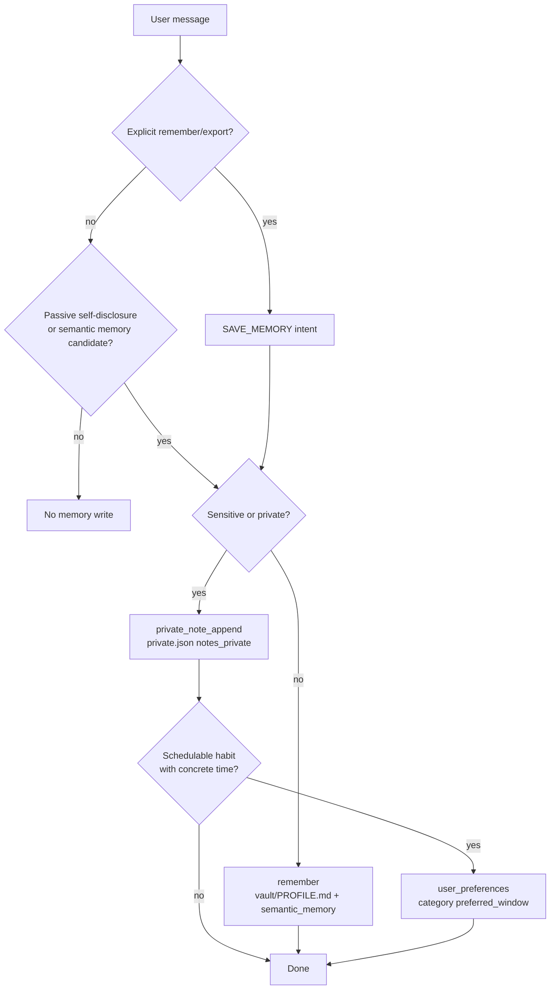

# Kairo + Orchestrator Architecture

This document describes the current Kairo orchestrator and controlled workflow
implementation. It is meant to be accurate enough for code review, not a
marketing diagram.

Primary source files:

- [`apps/api/kairo/agents/orchestrator/agent.py`](apps/api/kairo/agents/orchestrator/agent.py) - conversational router/translator/harness/humanizer over the PM agent
- [`apps/api/kairo/agents/orchestrator/router.py`](apps/api/kairo/agents/orchestrator/router.py) - heuristic plus model routing for direct vs delegated turns
- [`apps/api/kairo/agents/orchestrator/translator.py`](apps/api/kairo/agents/orchestrator/translator.py) - user request to structured PM trigger prompt
- [`apps/api/kairo/agents/orchestrator/harness.py`](apps/api/kairo/agents/orchestrator/harness.py) - PM result checking, retry, cache fallback, fallback logging
- [`apps/api/kairo/agents/personal_manager/agent.py`](apps/api/kairo/agents/personal_manager/agent.py) - sync/streaming entrypoints and tool-free fallback
- [`apps/api/kairo/agents/personal_manager/workflow.py`](apps/api/kairo/agents/personal_manager/workflow.py) - typed turn coordinator
- [`apps/api/kairo/agents/personal_manager/application/extraction.py`](apps/api/kairo/agents/personal_manager/application/extraction.py) - deterministic/model extraction arbitration
- [`apps/api/kairo/agents/personal_manager/application/planner.py`](apps/api/kairo/agents/personal_manager/application/planner.py) - intent-to-action planning
- [`apps/api/kairo/agents/personal_manager/application/approval_policy.py`](apps/api/kairo/agents/personal_manager/application/approval_policy.py) - destructive/privacy approval gates
- [`apps/api/kairo/storage/`](apps/api/kairo/storage) - working memory, approvals, audit, traces, personalization, semantic memory

## Package Layout

The backend package is split into layers, and imports only point down:

```text
api  ->  agents  ->  domains  ->  tools  ->  storage / core  ->  utils
```

| Layer | Holds | Examples |
| --- | --- | --- |
| `kairo/api/` | HTTP only: FastAPI app, auth, rate limits | `app.py`, `auth.py` |
| `kairo/agents/` | Anything that decides what to do with a message | `graph/` (2.0 agent graph), `orchestrator/`, `personal_manager/` (workflow, planning, clarification, `pending_reply.py`) |
| `kairo/domains/` | What Kairo can do, declared as typed tools grouped by area | `registry.py`, `tasks.py`, `checks.py`, `catalog.py` |
| `kairo/tools/` | Actions the agents can take | `executors/`, `calendar/`, `resolvers/`, `memory/`, `web_search.py` |
| `kairo/storage/` | All SQLite and file persistence | `control_store.py`, `working_memory.py`, `store.py` |
| `kairo/core/` | Shared foundations, no HTTP and no SQL | `llm.py` (contract gateway), `domain/`, `observability/` |
| `kairo/utils/` | Small helpers with no app state | `parsing/`, `clock.py`, `formatters.py`, `sensitivity.py` |
| `evals/` | Eval, judge and monitoring tools, outside the package | `judge_eval.py`, `pm_runner.py` |

`tests/test_architecture.py` fails if any module imports a layer above its own, or if
`kairo` imports `evals`.

## System Map



## Orchestrated Web Turn

The React app uses `/orchestrator/stream` for Kairo chat. The older
`/personal-manager/stream` endpoint still exists for direct Kairo PM streaming.



### Receipts

Storage is the evidence for a write. While the PM agent runs, every typed
action that writes is wrapped by `kairo/tools/receipts.py`: the user's stores
are read before and after, the difference is checked against the command, and a
`Receipt` (`kairo/core/domain/receipt.py`) records the result.

| Receipt | Meaning | Reply |
| --- | --- | --- |
| `verified` | The stores changed the way the command said | One sentence per stored change, from the stored record |
| `mismatch` | The stores changed, but not as the command said | The same, plus a note naming what differs |
| `failed` | The executor refused or errored | Its own explanation, or "nothing was saved" for an internal error |
| `unverified` | Success reported, nothing changed locally (already done, or written to Google Calendar) | Not used; the turn goes to the judge as before |

The decision log row for each orchestrator turn records what produced it in a
`versions` field: the prompts sent (name and version), the models, and the
receipt statuses.

An approved change is read back the same way; the sentence is kept with the
approval so sending the approval again returns the same reply. A receipt shows
what is stored, including the weekday, date and times, so a request the
workflow parsed wrongly is visible in the reply. It does not make the parse
right: the stores are compared with the command, not with what the user meant.

Important boundaries:

- The orchestrator can answer DIRECT for chat, support, or advice that does not
  require PM data.
- Delegated turns are translated into trigger-phrase-like PM prompts before
  reaching the typed PM workflow.
- Write turns invalidate the orchestrator PM cache.
- A write that was read back is never judged or rewritten by a model; the reply
  is built from the stored records.
- Harness fallback never fabricates write success; a write that could not be
  confirmed asks the user to retry or check the target data directly.
- Orchestrator memory is in-process and resets on backend restart. Durable PM
  state remains in Kairo's stores below.

## Agent Graph (Kairo 2.0, behind `KAIRO_AGENT=graph`)

With `KAIRO_AGENT=graph`, `/orchestrator/stream` runs
[`kairo/agents/graph`](apps/api/kairo/agents/graph) instead of the
orchestrator. Without it, nothing below is used. The graph takes domains over
one at a time: tasks so far. Everything else is handed, whole, to the
orchestrator described above.



How it differs from the orchestrated turn:

- **The model proposes; code decides.** `coordinate` is the only node that
  calls a model. It picks one tool and fills in typed arguments. It has no tool
  that writes.
- **One parse.** The arguments are the command. Nothing re-reads text
  afterwards, so there is no trigger phrase and no regex extraction on this
  path.
- **The gate can send a proposal back.** A due date that contradicts the
  message's own date word ("by friday" proposed as next week's Friday), a date
  in the past, or arguments that break the schema go back to the model once
  with the reason. If the second attempt fails too, nothing is stored and the
  user is asked.
- **Same execution path as before.** `act` uses `submit_action`
  (`application/approval_flow.py`), the function the typed workflow now uses
  too: approval policy, approval queue, executors, audit events, receipts.
- **A domain says when a request is not its own.** A check can answer "this
  belongs elsewhere" (a repeating reminder is not a task), and a lookup that
  finds nothing in the domain's own store hands the turn on, because the thing
  may be a calendar event or a habit.
- **One model call per turn** for a tasks request; none for approve or reject.
- **A question is asked once.** A question the graph asks is kept until the
  user's next message, shown to the coordinator then, and taken off the table.
  It cannot capture later messages.

Tools come from a registry (`kairo/domains`). A domain declares its tools as
`ToolSpec`s: a name, strict typed arguments whose docstring is the description
shown to the model, an optional `check`, and either `propose` (arguments to
typed commands) or `read`. `Registry.register` refuses a domain with a missing
part. A domain runs `inline` (its tools go to the coordinator) or as an `agent`
(the coordinator hands off); the orchestrator is registered as the `assistant`
agent domain for everything not yet moved.

The coordinator's prompt and every tool definition it is shown are hashed into
one bundle version, recorded with each turn in the decision log.

## PM Turn Flow



Notes:

- `run_pm()` supports a newline-based multi-task splitter when every non-empty
  line starts with an action prefix.
- `astream_pm()` handles one message and streams only the fallback/model reply;
  the typed workflow still returns whole deterministic replies.
- Fallback is intentionally tool-free. State-changing requests should be handled
  by the typed workflow before fallback is allowed.

## Extraction Arbitration

Extraction does not have a simple "regex first, model second" order. The current
logic compares optional structured model output with deterministic extraction and
keeps the safer or more complete plan.



Single-request extraction follows the same idea: model extraction may run when
configured, but deterministic extraction can override missing, unsafe, or
less-specific model output. Entity validation happens before execution.

## Intent And Policy Boundaries

`classify_pm_intent()` is a deterministic priority ladder for common request
families:

- approval/rejection acknowledgements
- destructive schedule/todo operations
- explicit memory export/remember requests
- sensitive or non-sensitive web-search requests
- todos, journal, habits, list/read requests
- schedule create/update/skip/cancel-series operations
- coaching/general conversation
- bare `add X` todo fallback

Policy decisions are deliberately outside the extractor:

- The extractor identifies user intent and entities.
- The workflow decides whether a pending dialogue state exists.
- The planner converts `PMIntent` into one or more typed `PMAction` objects.
- The approval policy decides whether an action can execute immediately.
- Executors mutate only through typed actions, not raw user text.

## Working Memory

Working memory is short-lived structured dialogue state stored in SQLite. It is
used for clarification, ranked choices, contextual confirmations, and activity
disambiguation.



The workflow clears stale pending state when the next message looks like a new
request rather than a dialogue reply. This prevents unrelated turns from being
silently absorbed into an old clarification or confirmation.

## Planning, Approval, Execution



Approval-gated actions include todo deletion, schedule removal/update, recurring
schedule modifications, private exports/patches, and sensitive web-search
requests.

## Learning And Personalization

Ranked clarification choices are generated by
`application/field_completion.py`. Candidate ranking can use:

- explicit preferences in `user_preferences`
- promoted behavioral patterns in `behavioral_patterns`
- prior shown/selected choices in `field_choice_memory`
- semantic activity/default windows
- calendar conflict and repetition penalties

Repeated selections can be promoted:

- `promote_patterns_from_choice_memory()` creates a behavioral pattern after at
  least 4 selected samples, 3 distinct selection days, and 55% selection rate
  within the last 90 days.
- `promote_preference_from_repeat_selects()` creates a broader
  `time_band_engagement` preference after repeated selections in the same scope.
- `decay_behavioral_patterns()` reduces inactive pattern confidence by 10% per
  30-day period and archives patterns below 0.25 confidence.

Explicit sensitive habit statements can also write a category-scoped
`preferred_window` preference when they contain a schedulable activity and a
concrete time.

## Persistence



Runtime data lives under `data/` or `apps/api/data/` depending on how the app is
started. Those directories are gitignored and should not be published.

## Memory Routing



The memory policy is conservative: sensitive facts go to private PM storage,
lower-risk stable preferences can be shared through profile/semantic memory, and
fallback memory writes are confidence-gated.
