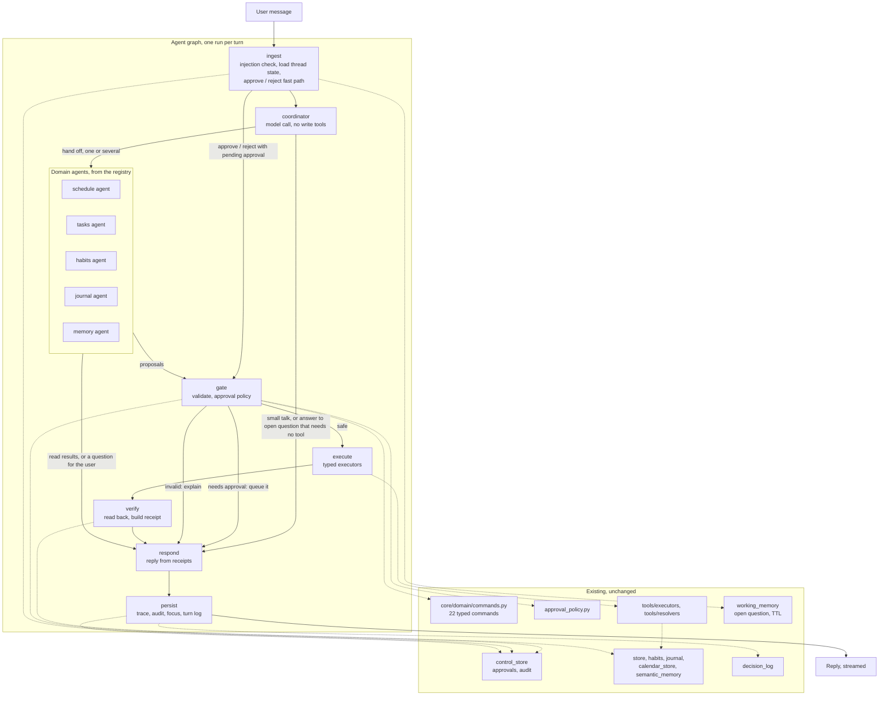
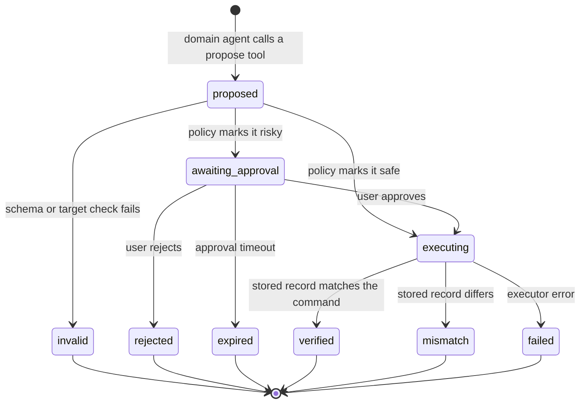
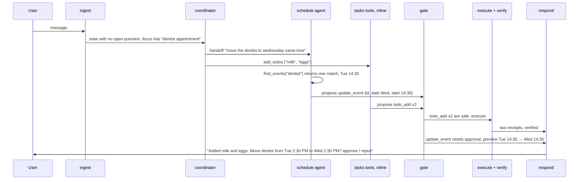

# Kairo 2.0 — Agent Architecture (proposal)

**Date:** 2026-11-12 · **Status:** Steps 1 to 5 of the build order (section 11) are done; the graph runs behind `KAIRO_AGENT=graph`.
**Context:** [idea-refine working doc](kairo-2.0-idea-refine.md), decision 9 ·
**Replaces, once built:** the orchestrator and PM sections of [`ARCHITECTURE.md`](../../ARCHITECTURE.md)

## 1. Summary

Kairo 1.0 understands a message with a model, flattens that understanding into
an English trigger phrase, and has regex rules re-parse the phrase. Most
observed mistakes come from that second parse. Kairo 2.0 removes it:

- A **coordinator** reads the message and the conversation state and decides
  who should handle it. It cannot write anything.
- **Domain agents** (schedule, tasks, habits, journal, memory) each get only
  their own tools. They read directly, but they can only **propose** changes,
  as typed commands.
- A deterministic **gate** validates every proposal, applies the approval
  policy, executes it, reads the stored record back and produces a **receipt**.
- The reply is built from receipts, so it cannot claim something that is not
  stored.

Everything on the safe side of the gate already exists and is kept: typed
commands, approval policy, executors, approval queue, audit log, decision
trace, slot recommendation, personalisation, storage.

Domains are plug-ins. Adding one means registering a `DomainSpec`; the graph,
the coordinator's routing prompt and the state layout do not change.

## 2. What goes wrong today

| Symptom (from trials) | Cause in the current design |
|---|---|
| "weekly 1:1 with Sara … at 10am" saved at 1 AM; "logo v2 due monday 5pm" saved at 2 AM | `extractors/` regex reads digits in the title as a time |
| Reply says "due Monday", stored value is Friday | The humanizer model writes the reply from the request, not from what was stored |
| "I couldn't confirm that was saved" on writes that did save | The judge model notices the re-parse lost a field, after the write is committed |
| Slot options repeated for seven turns, including after "Thank you" | `pending_reply.py` treats nearly any short message as an answer to the open question |
| "You have a call with Northwind at 2 PM" when nothing was saved | Direct replies are composed without reading the data |
| 3–12 second replies | Three to four sequential model calls per turn: translate, judge, humanize, sometimes route |

## 3. Design principles

1. **One parse.** The model's understanding goes straight into a typed tool
   call validated by a schema. Nothing re-interprets text afterwards.
2. **Models propose, code disposes.** No model-facing tool mutates data. Write
   tools return a proposed command; only the gate executes.
3. **Replies come from receipts.** A write is described from the record read
   back from storage. A read is described from tool results.
4. **State has owners.** Every field in the graph state has exactly one node
   allowed to write it.
5. **Domains are data.** The graph is generated from a registry.
6. **Keep what worked.** The approval gate, audit trail and typed execution
   passed every trial and stay as they are.

## 4. System overview



Model calls per turn:

| Turn | Today | Proposed |
|---|---|---|
| approve / reject | 0 | 0 |
| Simple write in an inline domain | 3–4 | 1 |
| Write handled by a domain agent | 3–4 | 2, sometimes 3 when it must look something up first |
| Several requests in one message | 3–4 per request, or lost | 1 coordinator call, then domain agents in parallel |

## 5. Nodes

| Node | Kind | Does | Reuses |
|---|---|---|---|
| `ingest` | Code | Runs the injection check. Loads the open question, pending approvals, focus and a memory snapshot into state. Sends a bare or id-carrying approve / reject straight to the gate | `_looks_like_injection`, `load_open_question`, `route_message` (approval part only), `list_approval_requests`, `build_memory_context` |
| `coordinator` | Model, one call, structured output | Decides what the message is: an answer to the open question, one or more new requests and which domain owns each, a cancel, or conversation. Never writes | `core/llm.py` contract gateway with repair; prompt versioning |
| Domain agent | Model, bounded tool loop | Uses its own read tools, then proposes commands or asks the user a typed question | LangGraph `create_react_agent` (already a dependency), resolvers, slot recommendation |
| `gate` | Code | Validates each proposal against its command schema, applies the approval policy, queues approvals with a before / after preview | `validate_action_payload`, `apply_approval_policy`, `create_approval_request`, `presentation/approval_preview.py` |
| `execute` | Code | Runs the typed action | `execute_pm_action` and the five executors |
| `verify` | Code | Reads the stored record back and compares it with the command, field by field | Store loaders; new per-domain `read_back` function |
| `respond` | Code, optional model polish for read summaries | Builds the reply from receipts, approval previews, the open question and read results | `utils/formatters.py`, `approval_preview.py` |
| `persist` | Code | Writes decision trace, audit events, focus, conversation turn | `TurnDecision`, `record_audit_event`, `append_orchestrator_turn` |

### Coordinator output

```python
class Handoff(Contract):
    domain: str                 # a registered domain name
    request: str                # the part of the message this domain owns, verbatim
    refers_to: list[str] = []   # focus entity ids the user pointed at ("it", "that call")

class CoordinatorDecision(Contract):
    open_question: Literal["answered", "cancelled", "unrelated", "none"]
    answer: dict | None         # must fit the open question's `expects` schema
    handoffs: list[Handoff]     # empty for pure conversation
    reply: str | None           # only when no handoff is needed
```

The coordinator says whether the message answers the open question. Code then
checks the answer against the question's `expects` schema. If it does not fit,
the question stays open and the message is treated as a new request. A model
opinion alone never resolves a question.

## 6. State control

### 6.1 Three tiers

```mermaid
flowchart LR
    subgraph T1["Turn state: graph channels, discarded after the turn"]
        A1["message, now, timezone"]
        A2["decision"]
        A3["proposals"]
        A4["receipts"]
        A5["read_results"]
        A6["budget"]
        A7["trace"]
    end
    subgraph T2["Thread state: one conversation, persisted"]
        B1["messages<br/>checkpointer"]
        B2["open_question<br/>working_memory"]
        B3["pending approvals<br/>approval_requests"]
        B4["focus: recently mentioned items<br/>recent_context"]
    end
    subgraph T3["User state: long-lived, persisted"]
        C1["domain data<br/>schedule, todos, habits, journal"]
        C2["profile, semantic memory"]
        C3["preferences, behavioural patterns"]
        C4["audit events, decision log"]
    end
    T2 -->|"loaded by ingest"| T1
    T3 -->|"read by tools and ingest"| T1
    T1 -->|"written by gate, execute, persist only"| T2
    T1 -->|"written by execute only"| T3
```



No new storage is introduced. Thread and user state stay in the tables that
exist today. The graph state is the working copy for one turn.

### 6.2 Graph state and ownership

```python
class KairoState(TypedDict):
    # turn inputs — written by ingest only
    message: str
    now: str                    # ISO datetime in the user's timezone
    calendar_hint: list[dict]   # next 14 days: {"date": "2026-11-17", "weekday": "Tue"}
    context: MemorySnapshot     # profile summary, preferences; read-only this turn

    # thread state, loaded by ingest
    messages: Annotated[list[AnyMessage], add_messages]
    open_question: OpenQuestion | None          # written by ingest, domain agents (ask), gate (resolve)
    pending_approvals: list[ApprovalRef]        # written by ingest, gate
    focus: Annotated[list[EntityRef], merge_focus]   # written by verify and read tools

    # turn working data
    decision: CoordinatorDecision | None        # written by coordinator
    proposals: Annotated[list[Proposal], append]     # written by domain agents
    read_results: Annotated[list[ReadResult], append] # written by domain agents
    receipts: Annotated[list[Receipt], append]       # written by verify
    budget: Budget                               # model calls and tokens used; checked by every model node
    trace: Annotated[list[TraceEvent], append]   # written by every node

    # extension point — one key per domain, owned by that domain
    domain: Annotated[dict[str, dict], merge_by_key]
```

| Field | Only this may write it | Why |
|---|---|---|
| `proposals` | Domain agents | A proposal is the only way a model can request a change |
| `receipts` | `verify` | A receipt is proof; models cannot mint one |
| `open_question` | Domain agents open one; `gate` resolves or parks it | Stops "any short message is an answer" |
| `focus` | `verify` and read tools | "It" always points at a real stored item |
| `domain[name]` | That domain's agent | New domains get state without touching the core schema |

Reducers (`append`, `merge_focus`, `merge_by_key`) let several domain agents
run in parallel in one turn without overwriting each other.

### 6.3 Proposal lifecycle



Each end state has a fixed reply shape. `verified` reads the record back in
full. `mismatch` says exactly which field differs and offers to fix it.
`failed` says nothing was saved. The existing approval states in
`control_store` (pending, claimed, executed, rejected) map onto the middle of
this diagram unchanged.

### 6.4 Open question lifecycle

```mermaid
stateDiagram-v2
    [*] --> open : domain agent asks, with an expects schema
    open --> resolved : coordinator says answered AND the answer fits expects
    open --> parked : message is unrelated; the new request is handled
    open --> cancelled : user says never mind
    open --> expired : TTL passes
    parked --> open : re-offered once, in the next reply
    parked --> expired : not taken up
    resolved --> [*]
    cancelled --> [*]
    expired --> [*]
```



An open question carries what it is waiting for:

```python
class OpenQuestion(BaseModel):
    id: str
    domain: str                    # who asked, and who resumes
    prompt: str                    # what the user was asked
    expects: dict                  # JSON schema of a valid answer, e.g. a choice id or {"date", "start"}
    choices: list[Choice] = []
    resume: Proposal | None        # the partial command to complete when answered
    state: Literal["open", "parked"]
```

This extends the existing `Pending` union in `core/domain/pending.py` and keeps
`working_memory` as its store, with the TTL and stale windows it has now. The
change is who decides: 328 lines of ordered regex rules become one model
judgment plus one schema check. `parked` is the new state, and it is the exit
the trials showed was missing.

## 7. Domain registry

```python
@dataclass(frozen=True)
class DomainSpec:
    name: str                          # "schedule"
    summary: str                       # one line, shown to the coordinator for routing
    read_tools: list[Tool]             # execute immediately, no side effects
    propose_tools: list[Tool]          # each returns a Proposal for one command type
    commands: dict[str, type[BaseModel]]   # action_type -> command schema
    risk: dict[str, str]               # action_type -> "medium" | "high"; absent means safe
    read_back: Callable[[PMAction, Ctx], dict | None]   # used by verify
    render: Callable[[Receipt], str]   # used by respond
    mode: Literal["agent", "inline"] = "agent"
    state_schema: type[BaseModel] | None = None   # shape of state["domain"][name]

DOMAINS = Registry()
DOMAINS.register(schedule_spec)
```

Section 8.1 refines this: the tool-related fields collapse into one
`tools: list[ToolSpec]`, and the rest are derived from it.

What the registry drives:

- The coordinator's routing prompt is assembled from each `summary`.
- The graph adds one node per `agent` domain and hands `inline` domains' tools
  to the coordinator directly.
- `gate` looks up the command schema and risk level by `action_type`. The risk
  table in `approval_policy.py` becomes the merged `risk` maps.
- `verify` and `respond` call the domain's `read_back` and `render`.

**`mode` settles the sub-agent question per domain instead of once for the
system.** An `inline` domain costs one model call per turn; an `agent` domain
costs two but gets its own prompt and tool set. Switching is a one-word
change, so it can follow measurements. Suggested start: `schedule` and
`memory` as agents, the rest inline.

Adding a domain later, for example expenses, means writing its command
schemas, executor, tools and `DomainSpec`. Nothing in the graph, the
coordinator or `KairoState` is edited.

## 8. Tools

Rules for every tool:

- Arguments are typed. Dates are ISO (`2026-11-17`), times are 24-hour
  (`17:00`). The model resolves "next Tuesday" using `now` and `calendar_hint`
  from state; the schema rejects anything else.
- Read tools return data and add what they found to `focus`.
- Propose tools return a `Proposal` and never touch storage.
- A tool that cannot proceed returns a typed error (`not_found`, `ambiguous`
  with candidates, `invalid`) so the agent can ask a precise question.

| Domain | Read tools | Propose tools → existing command |
|---|---|---|
| **schedule** | `list_events(from, to)`, `find_events(query, from, to)`, `check_conflicts(date, start, end)`, `suggest_slots(activity, date_range, duration)` | `create_event` → `schedule_add` · `update_event` → `schedule_update` · `remove_event` → `schedule_remove` · `skip_occurrence` → `schedule_add_exception` · `modify_occurrence` → `schedule_add_override` · `cancel_series_from` → `schedule_cancel_series_from` |
| **tasks** | `list_todos(status)`, `find_todos(query)` | `add_todos` (accepts a list) → `todo_add` · `complete_todo` → `todo_complete` · `remove_todo` → `todo_remove` |
| **habits** | `list_habits()`, `habit_streak(id)` | `add_habit` → `habit_add` · `checkin_habit` → `habit_checkin` · `remove_habit` → `habit_remove` |
| **journal** | `read_journal(limit)`, `search_journal(query)` | `append_journal` → `journal_append` |
| **memory** | `recall(query)`, `what_do_you_know()` | `remember` → `remember` · `save_private_note` → `private_note_append` |
| **shared** | `web_search(query)` with the existing sensitivity block | `ask_user(prompt, expects, choices)` opens a question |

Reuse behind the tools:

- `find_events`, `find_todos` wrap `tools/resolvers/`, which already handle
  fuzzy titles and ambiguity.
- `suggest_slots` wraps `time_slot_recommendation.py`, `field_completion.py`
  and `storage/personalization.py`. The ranking and learning logic is kept
  whole; it is called when the agent asks for it, instead of whenever a regex
  fails to find a time.
- `check_conflicts` is new and small. It closes the "double-booked with no
  warning" gap.
- Google Calendar stays behind `tools/calendar/service.py`; the schedule
  agent does not know which backend an event lives in.

Gaps the trials exposed that become new commands later, each a registry
addition: delete a journal entry, forget a memory, undo the last write,
"show everything you hold".

### 8.1 Managing tools as the system grows

**Today.** The model has no tools: the fallback agent is built with
`tools = []`, and the eight definitions in `tools/agent_tools.py` are unused.
The real "tools" are 22 typed actions, each spread across four files: schema
in `commands.py`, trigger in `planner.py`, approval in `approval_policy.py`,
behaviour in `executors/dispatcher.py`. Nothing ties the four together, so an
action added without an approval entry runs unapproved.

**Proposed: one `ToolSpec` per tool, everything else derived.**

```python
@dataclass(frozen=True)
class ToolSpec:
    name: str                       # "schedule.create_event", namespaced by domain
    kind: Literal["read", "propose"]
    description: str                # shown to the model
    args: type[BaseModel]           # existing command schema for propose tools
    action_type: str | None         # "schedule_add"; None for read tools
    risk: Literal["medium", "high"] | None    # None means safe
    execute: Callable | None        # existing executor function
    read_back: Callable | None      # required for propose tools
    render: Callable | None         # how the reply describes the receipt
    examples: list[ToolExample]     # at least one; doubles as eval cases
    version: int = 1
    enabled_for: Callable[[Ctx], bool] = always   # demo, self-host, experimental
```

`DomainSpec` in section 7 then holds `tools: list[ToolSpec]` in place of the
separate `read_tools`, `propose_tools`, `commands`, `risk`, `read_back` and
`render` fields. Those become views over the tool list.

Six rules:

1. **Single source of truth.** The model-facing description, approval table,
   executor lookup, verify step and eval cases are generated from `ToolSpec`.
2. **Two-level routing.** The coordinator sees domain summaries only. A
   specialist sees only its own tools. The coordinator's prompt stays the same
   size at 29 tools or 300. Keep each agent under about 15 tools; past that,
   split the domain.
3. **One contract.** Every tool returns the same envelope (`ok`, `data`, typed
   error: `not_found`, `ambiguous` with candidates, `invalid`). ISO dates and
   24-hour times only. Every write carries an idempotency key so a retry after
   a timeout cannot save twice.
4. **Policy is data.** Risk, approval, rate limit and availability are fields
   on the spec, so a tool can be enabled for self-hosters and disabled on the
   public demo without touching the graph.
5. **Startup check.** The app refuses to boot if a propose tool lacks a
   schema, executor, read-back, risk decision or example.
6. **Per-tool measurement.** Calls, errors, verify mismatches and latency are
   logged against the tool name in the existing decision trace.

Designed for, not built yet:

- **External integrations** enter as a domain whose operations are wrapped in
  `ToolSpec`s, with risk defaulting to approval-required. Google Calendar
  already has this shape behind `tools/calendar/service.py`.
- **Tool retrieval** (giving a specialist only the most relevant few of many
  tools) is unnecessary below about 15 tools per agent and adds a failure
  mode. Revisit only if one domain cannot be split.

| To add | Write | Leave untouched |
|---|---|---|
| A tool | One schema, one executor function, one read-back, one `ToolSpec` | Graph, coordinator, approval policy, verify |
| A domain | Its tools, a one-line summary, a mode | Graph, state schema, other domains |
| An integration | An adapter exposing its operations as `ToolSpec`s | Everything above |

### 8.2 Starting tool counts

| Agent | Read | Propose | Shared | Total |
|---|---|---|---|---|
| Coordinator (tasks, habits, journal inline) | 6 | 7 | 2 | 15 |
| Schedule agent | 4 | 6 | 1 | 11 |
| Memory agent | 2 | 2 | 1 | 5 |

29 distinct tools; `ask_user` is shared by all three. The coordinator is at
the suggested ceiling, so tasks is the first domain to promote to its own
agent when more tools are added.

### 8.3 Prompt versioning

**What exists (in progress on the `prompt-versioning` branch) and is kept.**
`core/prompt.py` declares every prompt once, versions it by the first 8 hex
digits of its content hash, tags the LangSmith run with `prompt.<name>`, and
`tests/fixtures/prompt_versions.json` snapshots all versions so an edit shows
up as a one-line diff. That solves "which text produced this trace" and
"nobody forgot to bump a number". Five gaps remain, and the new architecture
widens the first one.

| Gap | Why it matters | Change |
|---|---|---|
| **The prompt is no longer the whole instruction.** With tool calling, the model also reads every tool's name, description and argument schema, and the coordinator reads the domain summaries | Renaming a tool argument or rewording a description changes behaviour as much as editing the system prompt, and today's hash would not move | Version the **agent bundle**: one hash over the system prompt template, the tool specs the agent sees (name, description, JSON schema), and the domain summaries. One bundle per agent: `coordinator@…`, `schedule@…`, `memory@…` |
| **Model and settings are not part of the version** | The same text on a different model or temperature is a different system | Record the triple `bundle version · model id · parameters` everywhere a version is recorded |
| **A hash says a prompt changed, not whether it got better** | The snapshot test is satisfied by running `make prompt-versions`; nothing requires an eval | A **scores ledger**, `apps/api/evals/scores.jsonl` (built in step 4): one line per eval run with bundle versions, model, date, and the agreed metrics (right, wrong-but-reported-done, trapped turns, cost and latency). The snapshot test additionally requires a ledger entry for the current versions |
| **Old versions exist only in git history** | Cannot replay an old prompt against new cases, or roll back without a revert | Prompts live in files, `kairo/prompts/<name>.md`. Accepting a change copies the outgoing text to `kairo/prompts/archive/<name>@<version>.md`. `load_prompt(name, version=…)` can load either |
| **Versions are only on LangSmith traces** | The local decision trace and the UI cannot show them; without LangSmith there is no link between a bad turn and the prompt that produced it | `persist` writes the bundle versions and model id into `turn_decision_log`, and `emit("llm_usage", …)` carries them, so mismatch and fallback rates can be grouped by version |

Two smaller additions:

- **Pin or trial a version without a deploy.** A setting such as
  `KAIRO_PROMPT_SCHEDULE=3f2a9c1e` loads that archived version. A percentage
  split by thread id gives a side-by-side comparison on live traffic, with the
  ledger metrics computed per arm from the decision log.
- **A short reason with each change.** `make prompt-versions` takes a one-line
  note and stores it beside the new hash, so the snapshot diff reads
  `schedule: 1a478512 → 3f2a9c1e  "ask instead of guessing AM/PM"`.

What stays exactly as it is: content-hash identity, the `Prompt` and
`PromptTemplate` types, the name-clash guard, and the rule that a template's
version follows its wording and not the values filled in.

In the new design the hand-maintained `PROMPT_MODULES` list goes away: prompts
are discovered from the agent and domain registry, the same way tools are.

Migration note: the eleven prompts in the current snapshot belong to stages
that are retired in step 5 (`route`, `translate`, `judge`, `humanize`,
`plan_extraction`, `request_extraction`). The new set is small: `coordinator`,
one per agent-mode domain, and the optional read-summary prompt.

## 9. A turn, end to end

"move the dentist to wednesday same time and add milk and eggs to my list"



Three things here that fail today: two requests in one message, a comma list,
and an approval prompt that shows before and after.

## 10. Keep, change, retire

**Keep as is**

| What | Where |
|---|---|
| Typed commands and validation | `core/domain/commands.py` |
| Approval policy, approval flow, previews | `application/approval_policy.py`, `approval_flow.py`, `presentation/approval_preview.py` |
| Executors and resolvers | `tools/executors/`, `tools/resolvers/` |
| Approval queue, audit log, turn log | `storage/control_store.py` |
| Working memory with TTL and stale windows | `storage/working_memory.py` |
| Decision trace and its UI | `storage/decision_log.py`, `DecisionTracePanel.tsx` |
| Slot recommendation, ranking, learning | `time_slot_recommendation.py`, `field_completion.py`, `storage/personalization.py` |
| Semantic memory, profile, recent context | `storage/semantic_memory.py`, `profile.py`, `recent_context.py`, `tools/memory/` |
| Calendar sync | `tools/calendar/`, `storage/calendar_store.py` |
| Contract gateway, telemetry, tracing, prompt versioning | `core/llm.py`, `core/observability/`, `core/prompt.py` |
| HTTP layer, auth, rate limits, credits | `kairo/api/` |
| Injection check, sensitivity rules | `workflow.py` helper, `utils/sensitivity.py` |

**Change**

| What | From | To |
|---|---|---|
| `Pending` types | Parsed by regex rules | Gain `expects`, `domain`, `resume`, `parked` |
| `PMAction` | Built by the planner from intent + entities | Built directly from a propose tool's arguments |
| `tools/agent_tools.py` | Eight coarse tools with an `operation` string | One typed tool per command, grouped by domain |
| Risk table | One dict in `approval_policy.py` | Merged from each `DomainSpec.risk` |
| Harness | Model judges reply text | `verify` compares stored record to command; `harness.py` fallback logging kept |
| Orchestrator memory | In-process, lost on restart | `messages` through the SQLite checkpointer already in use |
| Evals | Check extracted intent and entities | Check stored state after the turn; the 85 trial messages become the blind set |

**Retire, after the new path passes the quality bar**

| What | Where | Lines |
|---|---|---|
| Intent ladder and entity regex | `extractors/intent.py`, `entities.py`, `model.py` | 779 |
| Extraction arbitration | `application/extraction.py` | 546 |
| Pending reply rules and reply parsing | `application/pending_reply.py`, most of `clarification.py` | about 1,200 |
| Planner | `application/planner.py` | 277 |
| Trigger-phrase translator, keyword router, judge, humanizer | `orchestrator/translator.py`, `router.py`, parts of `agent.py`, `prompts.py` | about 500 |
| Text parsing helpers no longer called | parts of `utils/parsing/` | to be checked |

`utils/parsing/datetime.py` and `recurrence.py` are likely still useful as
validators inside tool schemas. Decide per function during migration.

## 11. Migration

Built beside the current path behind a setting (`KAIRO_AGENT=graph`), so the
live path keeps working and both can be scored on the same messages.

Order revised on 2026-11-12: measure first, test the riskiest assumption early,
and improve the live path before the rewrite is finished.

| Step | Delivers | Why here | Status |
|---|---|---|---|
| 1 | **Blind eval set and state-based scorer.** 85 un-coached messages with expected stored outcomes, runnable against any path | Every later step is judged against it | Done — see [BLIND_EVAL.md](../BLIND_EVAL.md) |
| 2 | **Model date test.** Can the small model fill `create_event` correctly for the set's date and time phrasings? | The assumption the whole design rests on; a day to check | Done — see [MODEL_DATE_TEST.md](../MODEL_DATE_TEST.md). Holds on `gpt-4o-mini` once a date check and pick-and-show for bare hours are added (0 wrong of 282 in the follow-up run); without them it is 9% wrong |
| 3 | **Gate, execute, verify and receipts, wired into the current live path** | Replaces the judge and humanizer for writes now: no false "couldn't confirm", no reply that disagrees with storage, two fewer model calls | Done — `kairo/tools/receipts.py`, [results](../BLIND_EVAL.md#after-step-3-receipts-on-the-web-chat-path). "Couldn't confirm" replies 32 → 1, calls per turn 2.5 → 2.0, median reply 4.9 s → 3.2 s. Wrong saves unchanged, as expected |
| 4 | **Scores ledger and versions in the decision log** (section 8.3) | From here every prompt or tool change is scored and recorded | Done — ledger at `apps/api/evals/scores.jsonl` ([how to use it](../BLIND_EVAL.md#the-scores-ledger)); each orchestrator decision row has a `versions` field. The bundle hash, prompt archive and pin-or-trial setting from section 8.3 wait for the tool registry |
| 5 | **Registry, graph state, coordinator, tasks inline** | The simplest end-to-end slice of the new graph | Done — `kairo/domains/` and `kairo/agents/graph/`, behind `KAIRO_AGENT=graph`; the orchestrator is untouched and takes every hand-off; the typed workflow now submits commands through the same `submit_action` the graph uses, with no change in behaviour (252 of 252 on the old suite). On the 20 task turns of the blind set: 19 right, 0 wrong, 1 safe miss, 1.05 model calls and 1.2 s median, against 9 right and 9 wrong on web chat ([results](../BLIND_EVAL.md#after-step-5-tasks-on-the-agent-graph)). Not built yet from this step's scope: the startup check that refuses to boot (the registry refuses an incomplete domain at import instead), the prompt archive and the pin-or-trial setting |
| 6 | **Schedule agent, with open questions built in** (`expects`, `parked`) | The schedule agent cannot work without asking for a missing time; fixes the pending trap where it occurs | |
| 7 | **Several requests in one message, in parallel** | An optimisation, not a prerequisite | |
| 8 | **Memory agent, then habits and journal** | Each is a registry entry; confirms the extension path | |
| 9 | **Switch the web path over, retire the old modules, re-target the old suite** | Last, so there is always a working system to compare against | |

Gate for each step, from the metrics already agreed and now enforced by
`python -m evals.blind --gate`: wrong-but-reported-done at or below 2%, trapped
turns 0, right rate at or above 70% of scoreable turns. Reply time (2 seconds
typical) is reported by the same run.

## 12. Risks and open decisions

| Risk | Mitigation |
|---|---|
| The model gets relative dates wrong | `calendar_hint` in state; schema accepts ISO only; `verify` reads back the weekday in the reply so the user sees it |
| Two model calls still miss the 2-second target | `inline` mode per domain; parallel handoffs; measure in step 1 before building more agents |
| Stored text (journal, event titles) carries injected instructions into a domain agent | Tool results are marked as data in the prompt; the gate and approval policy do not depend on the model behaving |
| Every turn now needs a model; the $20 cap | Approve / reject stay free; per-visitor turn budget; measure real token use in step 1 |
| The 252-case suite loses meaning during migration | Keep it running against the old path until step 5; add state-based checks alongside |

Decisions for Jeffery:

1. **Agent or inline per domain at the start.** Proposed: schedule and memory
   as agents, tasks, habits and journal inline.
2. **Model.** Decided 2026-11-13: `gpt-4o-mini`. `gpt-5.4-mini` got about 1%
   of date and time answers wrong against 9% for `gpt-4o-mini`, but was judged
   too expensive. With a date check in the gate and pick-and-show for bare
   hours, `gpt-4o-mini` had no wrong answers in a fresh run of 282
   ([follow-up](../MODEL_DATE_TEST.md#follow-up-staying-on-gpt-4o-mini)). The
   test made five contract elements requirements: the calendar hint in state,
   one proposal per request, tool wording that says a task never repeats or
   holds time, past-date and repeat-shape checks, and the date check against
   the message's own date word. "One proposal per request" means several
   requests in one message must be split by the coordinator or carried in a
   list-typed tool, not left to parallel tool calls.
3. **Whether `respond` may use a model.** Proposed: templates for writes and
   approvals, optional model wording for read summaries only.
4. **Where this lives in the code.** Proposed: a new `kairo/agents/graph/`
   package and `kairo/domains/<name>/`, leaving `orchestrator/` and
   `personal_manager/` untouched until step 5.
5. **A bare hour.** Decided 2026-11-13: pick the likelier reading and show it
   in the receipt. Asking only worked on `gpt-5.4-mini`.
